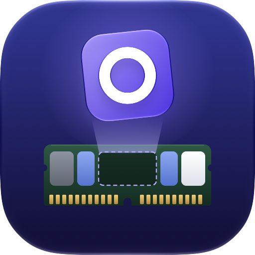
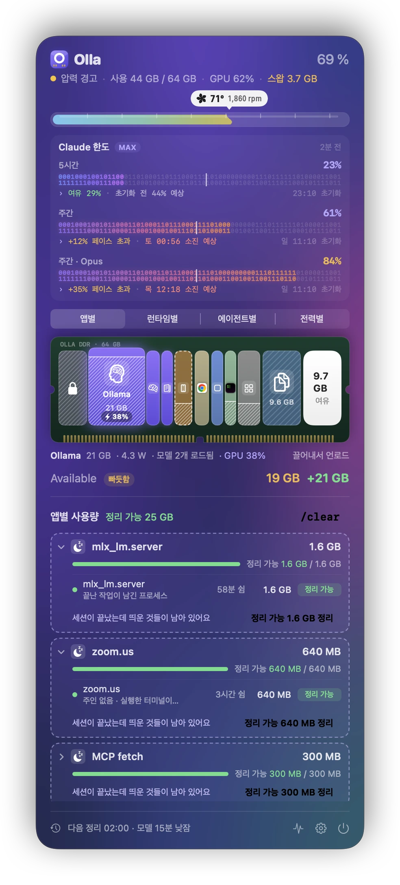
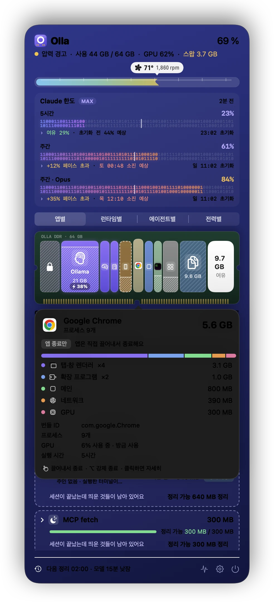
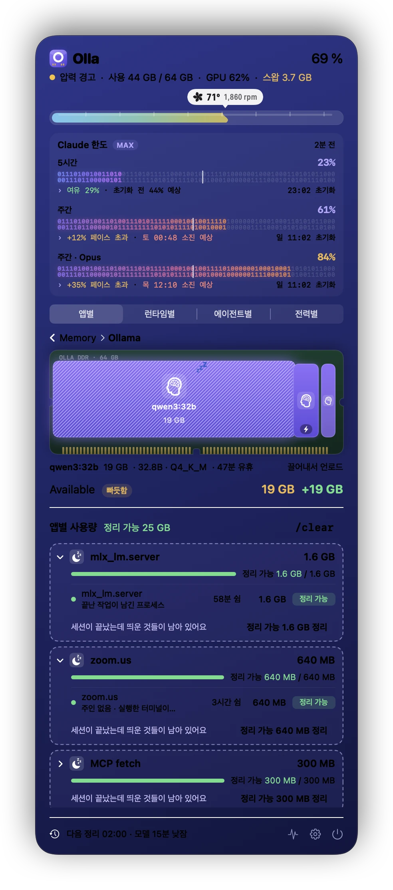
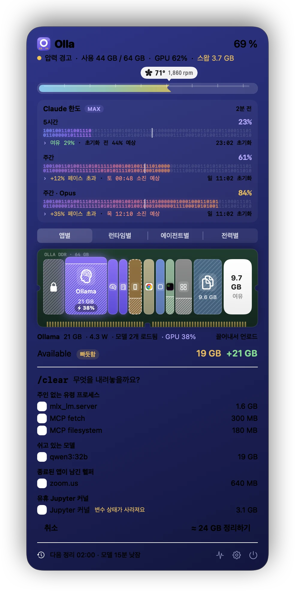
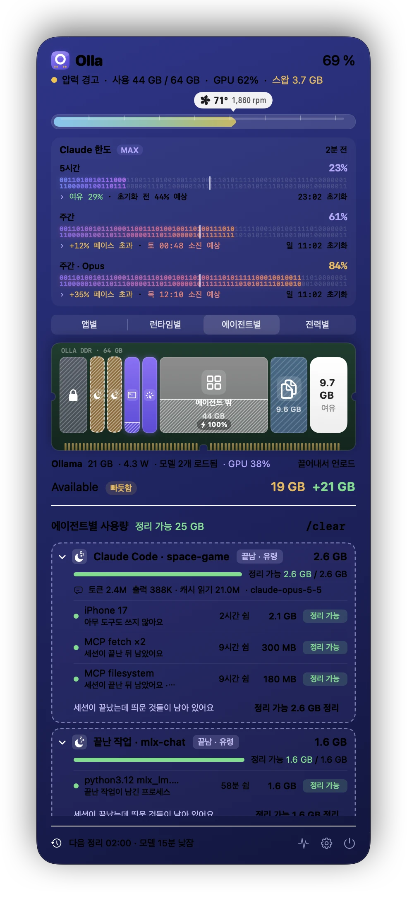
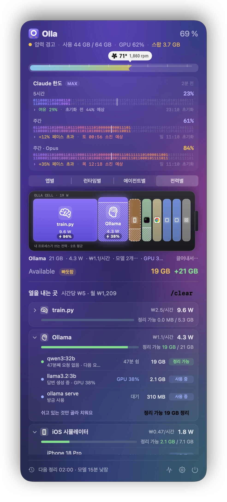
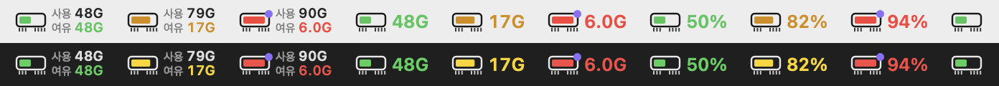
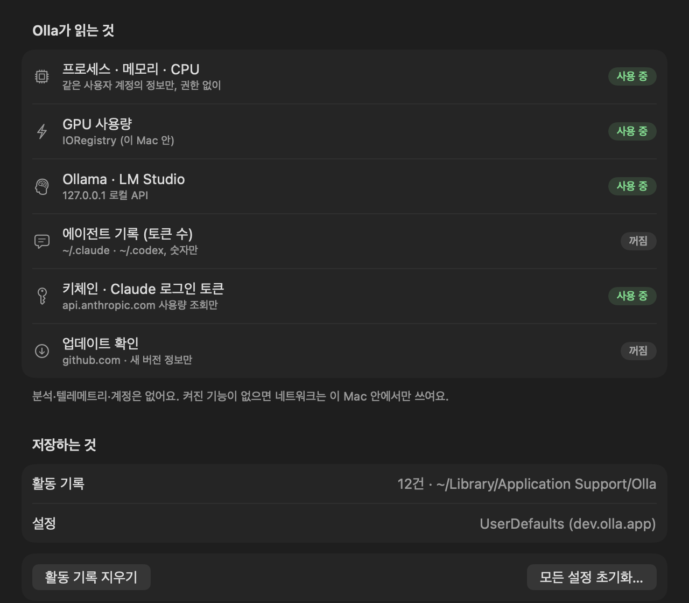

# Olla

**Offload LLM Leftovers Automatically** 
*Clear your Mac's context.*

AI 시대를 위한 macOS 메뉴바 메모리 관리자예요. 
메모리를 **RAM 스틱 위 블록**으로 보여주고, 블록을 **패널 밖으로 끌어내면** 메모리를 비워요.

### [⬇︎ Olla 내려받기](https://github.com/DIJEONG/olla-releases/releases/latest)

macOS 26 Tahoe 이상 · Apple 실리콘·Intel · Apple 서명·공증 완료

[English](README.md)

> 스크린샷은 모두 Olla에 들어 있는 데모 데이터예요.

---

## 왜 Olla인가요?

로컬 LLM을 쓰다 보면 메모리가 이런 식으로 새요.

- 터미널을 닫았는데 **`mlx_lm.server`가 혼자 남아** 1.6 GB를 붙잡고 있어요.
- Ollama가 **47분째 질문을 받지 않은 32B 모델**을 19 GB 그대로 들고 있어요.
- 코딩 에이전트가 끝났는데 **MCP 서버와 `uv run` 프로세스**가 9시간째 떠 있어요.
- 에이전트가 테스트하려고 켠 **iOS 시뮬레이터**가 아무도 안 쓰는데 15 GB를 쓰고 있어요.
- 4시간 전에 열어 둔 **Jupyter 커널**이 3 GB를 차지하고 있어요.

기존 메모리 클리너는 "inactive 메모리 퍼지"처럼 무엇을 지우는지 보이지 않는 방식이 많아요. 활성 상태 보기는 표만 보여줘요. Olla는 **무엇이 메모리를 먹는지 보여주고, 손으로 집어서 버리게** 해요.

## 주요 기능

### 🧩 RAM 스틱 패널

- 메모리를 회로 기판 위 칩 블록으로 보여줘요: 시스템 🔒 · AI · 앱 · 기타 · 캐시 · 여유.
- 칩을 **클릭**하면 하위 구성으로 들어가요(앱 → 프로세스, Ollama → 모델).
- 블록을 **패널 밖으로 끌어내면** 비워요. 대상마다 동작이 달라요.

| 끌어낸 블록 | 놓으면 | ⌥ + 놓기 |
|---|---|---|
| 모델 (Ollama·LM Studio) | 언로드 (서버는 유지, 다음 요청 때 다시 로드) | 서버까지 종료 |
| 일반 앱 | 정상 종료 (저장 확인은 앱이 직접) | 강제 종료 |
| 👻 Python·MCP·잔여 헬퍼 | SIGINT → SIGTERM 단계적 정리 | SIGKILL |
| iOS 시뮬레이터 | `simctl shutdown` | — |
| 🔒 시스템·커널 | 거부 | — |

끝나면 "다시 열기" 알림이 떠요. launchd가 다시 띄우면 그 원인(KeepAlive 라벨)도 알려줘요.

### 🔍 호버 상세 카드

칩 위에 마우스를 올려 두면 구성을 보여줘요. Chromium·Electron 앱(Chrome, Edge, Brave, Slack, VS Code, Claude 등)은 **탭 렌더러 · 확장 프로그램 · GPU · 네트워크 · 메인**으로 나눠서 보여줘요.

### 👻 유령 탐지 & `/clear`

- **유령**: 실행한 터미널이나 에이전트가 사라졌는데 혼자 남아 아무 일도 안 하는 프로세스예요.
- **`/clear`**: 무엇을 왜 정리하는지 체크리스트로 보여준 다음 실행해요. 끝나면 되찾은 메모리를 알려줘요.

| 사유 | 기본 선택 |
|---|---|
| 주인 없는 유령 프로세스 (고아 + 유휴) | ✅ |
| 쉬고 있는 모델 (N분 무요청 + GPU 미사용) | ✅ |
| 종료한 앱이 남긴 헬퍼 | ✅ |
| 아무도 안 쓰는 시뮬레이터 | ✅ |
| 유휴 AI 런타임 | ☐ |
| 유휴 Jupyter 커널 (변수 상태가 사라져요) | ☐ |

### 🤖 네 가지 보기: 앱별 · 런타임별 · 에이전트별 · 전력별

- **에이전트별**은 Claude Code·Codex·Cursor·Claude 앱 세션마다 띄운 프로세스와 시뮬레이터를 묶고, **세션이 끝난 뒤 남은 것**을 한 덩어리로 보여줘요.
- 항목마다 **정리 가능 · 주의 · 사용 중 · 앱 종료만**과 그 이유(예: "살아 있는 세션이 쓰는 MCP 서버", "포트 5173에 연결 1개")를 보여줘요. "정리 가능만 정리"는 초록 항목만 치워요.
- **전력별**은 프로세스별 전력(W)을 배터리 모양 칸에 보여주고, 사는 지역의 전기 요금으로 시간당·월간 비용도 계산해요.

### 📈 Claude 요금제 한도와 토큰 수 (선택)

- Claude Code·Codex가 이 Mac에 남긴 기록에서 세션별 토큰 수를 보여줘요.
- Claude **5시간·주간 사용률**, 페이스보다 빠른지 느린지, 이대로면 언제 소진되는지, 언제 초기화되는지 보여줘요.

### ⚡ GPU와 칩 온도

- 상단에 GPU 전체 사용률, 칩마다 프로세스별 GPU 사용률(⚡)을 보여줘요.
- LLM 추론은 주로 GPU를 써요. 그래서 **CPU가 조용해도 GPU를 쓰면 "사용 중"**으로 봐요.
- 온도계가 가장 뜨거운 칩 온도를 보여주고, 그 안의 팬은 실제 팬 속도로 돌아요.

### 📊 메뉴바만 봐도 아는 상태

- **사용 · 여유** 두 줄 표시(기본), 여유만, 사용 %, 아이콘만 중에서 골라요.
- 여유(빈 메모리 + 바로 비울 수 있는 캐시)가 전체의 **25% 이상이면 초록, 10~25%면 노랑, 10% 미만이면 빨강**이에요. 메모리 압력이 높으면 한 단계 올려요.
- 정리할 유령이 있으면 아이콘에 보라색 점이 떠요.

### ⏰ 자동화

기본 프리셋 "로컬 AI 개발자"가 들어 있고, 모두 설정에서 바꿀 수 있어요.

- 💤 **모델 낮잠**: 15분 동안 요청이 없으면 모델을 언로드해요.
- 👻 **유령 정리**: 30분 동안 아무 일도 안 한 유령을 정리해요.
- 📈 **메모리 압력**: 경고가 2분 넘게 이어지면 `/clear`를 실행해요.
- 🕑 **매일 02:00**: 잠자기 때문에 놓치면 깨어난 직후 실행해요.
- 활동 기록: "이번 주 Olla가 되찾은 메모리 142 GB"

Olla는 **한국어·영어·일본어**를 지원하고, 라이트·다크 모드를 따라가요.

## 설치

1. [Releases](https://github.com/DIJEONG/olla-releases/releases/latest)에서 최신 `Olla-x.y.z.dmg`를 내려받아요.
2. 열어서 **Olla**를 **응용 프로그램** 폴더로 끌어다 놓아요.
3. Olla를 실행해요. Dock이 아니라 메뉴바에 있어요. 작은 RAM 스틱 아이콘을 누르면 패널이 열려요.

Olla는 Developer ID로 서명하고 Apple 공증을 받았어요. 그래서 처음 열 때도 경고 없이 열려요.

## 업데이트

Olla는 [Sparkle](https://sparkle-project.org)로 스스로 업데이트해요.

- 두 번째 실행 때 업데이트를 자동으로 확인할지(하루 한 번) 물어봐요. **설정 → 정보**에서 언제든 바꿀 수 있어요.
- **설정 → 정보 → 업데이트 확인**을 누르면 바로 확인해요.
- 모든 업데이트는 서명을 확인한 뒤 설치하고, 직접 확인하기 전에는 아무것도 설치하지 않아요.

## 개인정보

- **분석·텔레메트리·계정은 없어요.**
- 기본 상태에서는 로컬 런타임 API(`127.0.0.1`, Ollama·LM Studio)에만 연결해요.
- 활동 기록은 이 Mac의 `~/Library/Application Support/Olla`에만 저장해요.
- 선택 기능은 모두 **기본으로 꺼져 있어요**.
  - **토큰 수:** `~/.claude/projects`, `~/.codex/sessions`에서 토큰 숫자·모델명·시각만 읽어요. 대화 내용은 저장하거나 보내지 않아요.
  - **Claude 요금제 한도:** macOS 허용 창을 거쳐 Claude Code가 키체인에 저장한 로그인 토큰을 읽고, `api.anthropic.com`에 사용량 숫자만 물어봐요. 토큰은 저장·복사·갱신하지 않아요. 비공식 API라서 바뀌면 동작하지 않을 수 있어요.
  - **업데이트 확인:** 하루 한 번 `github.com`에서 `appcast.xml`만 내려받아요. 시스템 정보는 보내지 않아요.

**키체인 허용 창 안내.** Claude 요금제 한도를 켜면 macOS가 "Claude Code-credentials" 사용을 허용할지 물어봐요. Mac 로그인 암호를 입력하고 **항상 허용**을 누르면 다시 묻지 않아요.

## 안전 원칙

- **CPU나 GPU를 쓰는 프로세스는 주인이 없어도 건드리지 않아요.** (`nohup`으로 돌리는 학습 등)
- **살아 있는 에이전트의 MCP 서버는 유휴처럼 보여도 제안하지 않아요.** MCP 서버는 원래 호출을 기다리며 쉬는 게 정상이에요.
- 시뮬레이터는 Xcode·Simulator 앱·`xcodebuild`·`simctl` 중 하나라도 쓰고 있으면 사용 중으로 봐요.
- 앱을 켠 직후 1분 동안은 관찰만 하고 자동 정리를 하지 않아요.
- macOS 시스템 프로세스, Finder·Dock·WindowServer, Olla 자신은 항상 잠겨 있어요. 블록을 우클릭해서 **항상 보호** 목록에 넣을 수도 있어요.
- 정상 종료가 기본이에요. 강제 종료는 ⌥를 누르거나 메뉴에서 직접 골랐을 때만 해요.

## 자주 묻는 질문

**왜 Mac App Store에 없나요?**
Mac App Store 앱은 App Sandbox 안에서 돌아야 해요. 샌드박스 안에서도 메모리를 보여줄 수는 있지만, 다른 프로세스를 종료할 수 없어요. 그게 Olla의 핵심 기능이라 직접 배포해요.

**오픈 소스인가요?**
아니요. 이 저장소에는 릴리스, 스크린샷, 이슈 트래커만 있어요. 소스 코드는 비공개예요.

**Intel Mac에서도 되나요?**
네. 다만 프로세스별 GPU 사용률과 칩 온도는 Apple 실리콘 센서에서 읽어서, 값을 읽을 수 없는 Mac에서는 숨겨져요.

**어떻게 지우나요?**
Olla를 종료하고(패널의 전원 버튼) 응용 프로그램 폴더에서 휴지통으로 옮기면 돼요. 데이터까지 지우려면 `~/Library/Application Support/Olla`를 지우고 터미널에서 `defaults delete dev.olla.app`을 실행해요.

## 의견 보내기

버그를 찾았거나 아이디어가 있으면 [이슈를 남겨 주세요](https://github.com/DIJEONG/olla-releases/issues).
**설정 → 정보 → 진단 정보 복사**를 누르면 macOS 버전·칩·메모리·켜진 기능(개인 정보 없음)이 복사돼요. 이슈에 붙여 넣어 주세요.

---

만든 사람 [DIJEONG](https://github.com/DIJEONG) · © 2026 DIJEONG. All rights reserved.
