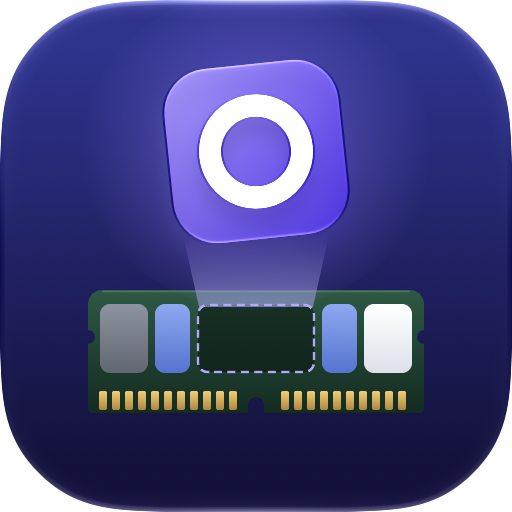
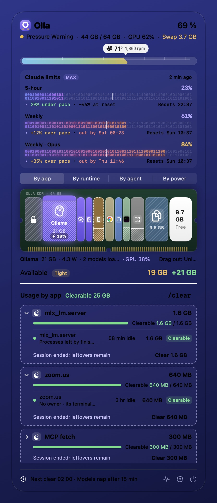
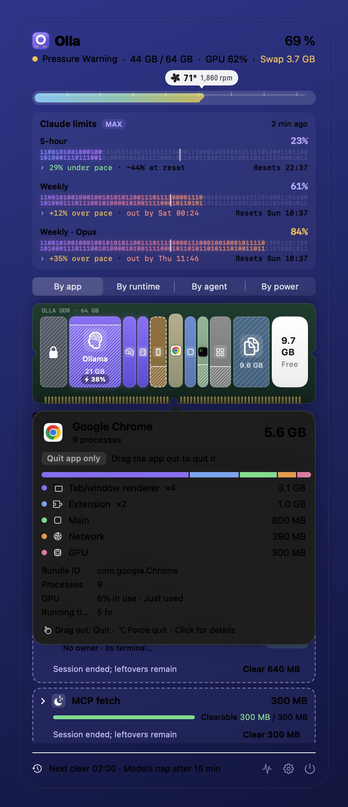
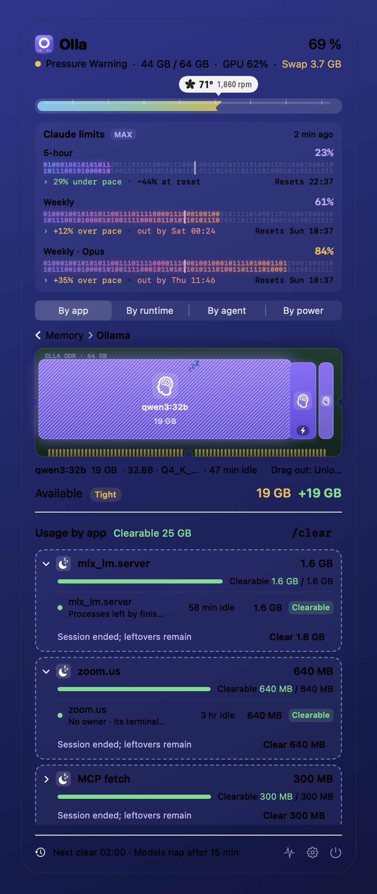
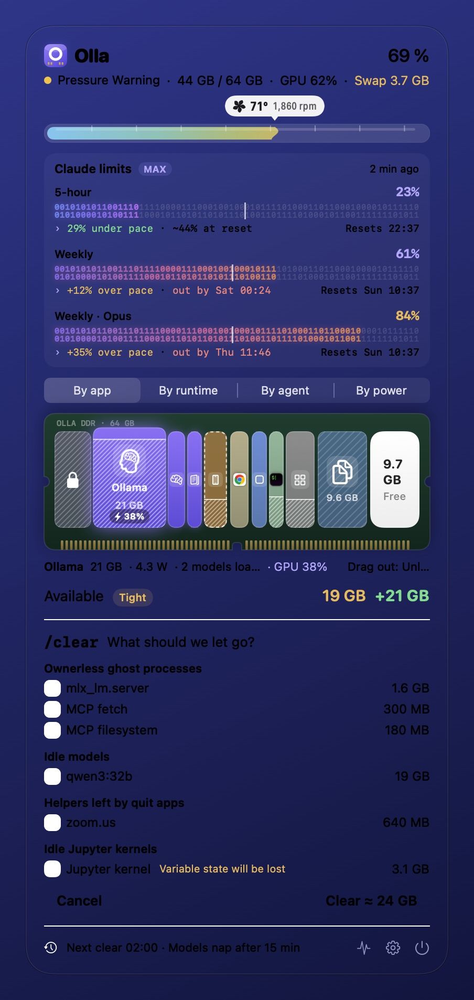
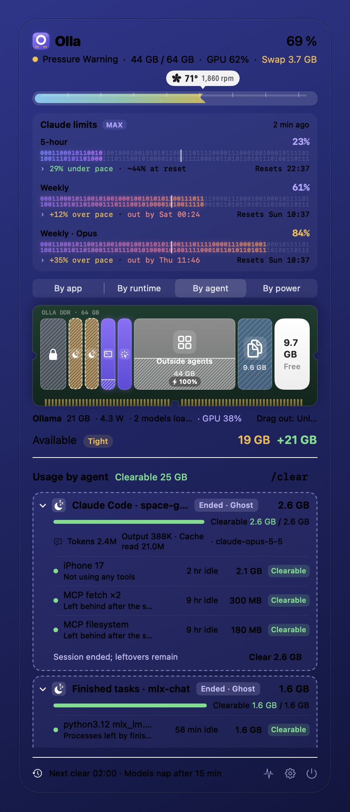
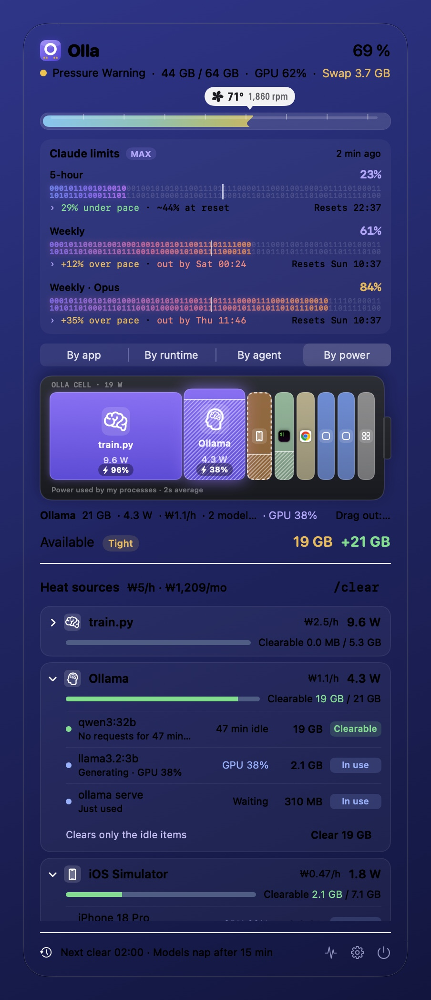
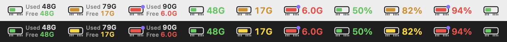
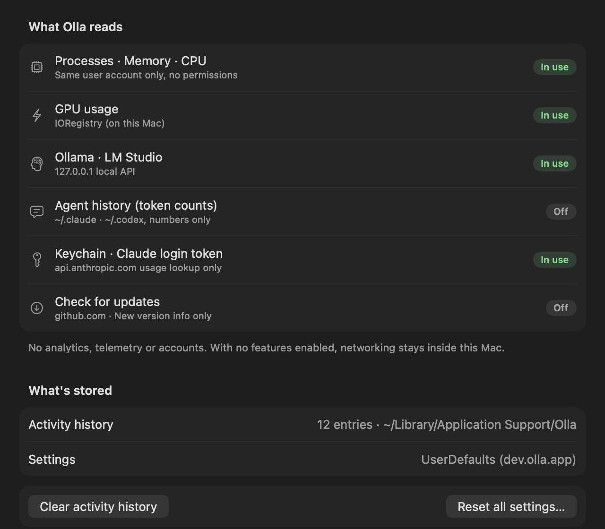

# Olla

**Offload LLM Leftovers Automatically** 
*Clear your Mac's context.*

A menu bar memory manager for the AI era. 
Olla draws your Mac's memory as blocks on a RAM stick. Drag a block out of the panel to free it.

### [⬇︎ Download Olla](https://github.com/DIJEONG/olla-releases/releases/latest)

macOS 26 Tahoe or later · Apple silicon and Intel · Signed and notarized by Apple

[한국어](README.ko.md)

> All screenshots use Olla's built-in demo data.

---

## Why Olla?

If you run local LLMs, memory leaks away like this:

- You closed the terminal, but **`mlx_lm.server` is still holding 1.6 GB**.
- Ollama keeps a **32B model nobody has asked anything for 47 minutes** loaded at 19 GB.
- The coding agent finished, but its **MCP servers and `uv run` processes** have been idle for 9 hours.
- The **iOS Simulator** an agent booted for a test is using 15 GB, and no one is using it.
- A **Jupyter kernel** from four hours ago is sitting on 3 GB.

Many memory cleaners "purge inactive memory" without showing what they remove. Activity Monitor gives you a table. Olla **shows what is eating your memory and lets you pick it up and throw it away.**

## Features

### 🧩 The RAM stick panel

- Memory appears as chips on a circuit board: system 🔒 · AI · apps · other · cache · free.
- **Click** a chip to drill down (app → processes, Ollama → models).
- **Drag a block out of the panel** to free it. What happens depends on what you drag:

| Dragged block | Drop | ⌥ + drop |
|---|---|---|
| Model (Ollama, LM Studio) | Unload (the server keeps running and reloads on the next request) | Stop the server too |
| Regular app | Quit normally (the app asks you to save) | Force quit |
| 👻 Python, MCP, leftover helpers | Staged cleanup: SIGINT → SIGTERM | SIGKILL |
| iOS Simulator | `simctl shutdown` | — |
| 🔒 System, kernel | Refused | — |

Afterwards a notification offers **Reopen**. If launchd restarts something, Olla tells you why (the KeepAlive label).

### 🔍 Hover detail cards

Rest the pointer on a chip to see what's inside. Chromium and Electron apps (Chrome, Edge, Brave, Slack, VS Code, Claude and more) are split into **tab renderers · extensions · GPU · network · main**.

### 👻 Ghost detection and `/clear`

- A **ghost** is a process whose terminal or agent is gone, left behind and doing nothing.
- **`/clear`** shows a checklist of what it will free and why, then does it and reports how much memory came back.

| Reason | Selected by default |
|---|---|
| Ownerless ghost processes (orphaned and idle) | ✅ |
| Idle models (no requests for N minutes, GPU unused) | ✅ |
| Helpers left behind by apps you quit | ✅ |
| Simulators nobody is using | ✅ |
| Idle AI runtimes | ☐ |
| Idle Jupyter kernels (their variables are lost) | ☐ |

### 🤖 Four lenses: by app, runtime, agent and power

- **By agent** groups the processes and simulators each Claude Code, Codex, Cursor or Claude app session started, and collects **what was left after a session ended** into one block.
- Every item is marked **Clearable · Caution · In use · Quit app only**, with the reason (for example "MCP server used by a live session" or "1 connection on port 5173"). "Clear clearable only" removes just the green ones.
- **By power** shows per-process watts in a battery-shaped cell, with the cost per hour and per month at your local electricity price.

### 📈 Claude plan limits and token counts (optional)

- Tokens per agent session, read from the records Claude Code and Codex keep on your Mac.
- Your Claude **5-hour and weekly usage**, whether you're over or under pace, when you'll run out at this rate, and when each window resets.

### ⚡ GPU and chip temperature

- Total GPU usage at the top and per-process GPU usage (⚡) on each chip.
- LLM inference mostly runs on the GPU, so **a process that uses the GPU counts as busy even when its CPU is quiet**.
- A thermometer shows the hottest chip temperature, with a fan that spins at the real fan speed.

### 📊 Status at a glance in the menu bar

- Choose **Used · Free** on two lines (default), free only, used %, or icon only.
- **Green** when 25% or more is free (free memory plus cache macOS can drop right away), **yellow** at 10–25%, **red** below 10%. High memory pressure moves it up one level.
- A violet dot appears when there are ghosts to clear.

### ⏰ Automation

Comes with a "Local AI developer" preset. Everything can be changed in Settings.

- 💤 **Model nap**: unload a model after 15 minutes without requests.
- 👻 **Ghost cleanup**: clear ghosts that have done nothing for 30 minutes.
- 📈 **Memory pressure**: run `/clear` when a warning lasts more than 2 minutes.
- 🕑 **Daily at 02:00**: if the Mac was asleep, it runs right after waking.
- Activity history: "Olla recovered 142 GB this week."

Olla speaks **English, Korean and Japanese**, and follows your light or dark appearance.

## Install

1. Download the latest `Olla-x.y.z.dmg` from [Releases](https://github.com/DIJEONG/olla-releases/releases/latest).
2. Open it and drag **Olla** to **Applications**.
3. Open Olla. It lives in the menu bar, not the Dock. Click the small RAM stick to open the panel.

Olla is signed with a Developer ID and notarized by Apple, so it opens without Gatekeeper warnings.

## Updates

Olla updates itself with [Sparkle](https://sparkle-project.org).

- On the second launch it asks whether to check for updates automatically (once a day). You can change this any time in **Settings → About**.
- **Settings → About → Check for updates** checks right away.
- Every update is signed and verified before it installs, and nothing installs until you confirm.

## Privacy

- **No analytics, telemetry or accounts.**
- Out of the box, Olla only connects to local runtime APIs on `127.0.0.1` (Ollama, LM Studio).
- Activity history stays in `~/Library/Application Support/Olla` on your Mac.
- Optional features, all **off by default**:
  - **Token counts:** reads only token numbers, model names and times from `~/.claude/projects` and `~/.codex/sessions`. Conversations are never stored or sent.
  - **Claude plan limits:** after macOS asks you, Olla reads the login token Claude Code saved in your keychain and asks `api.anthropic.com` for usage numbers only. The token is never stored, copied or refreshed. This endpoint is unofficial and may change.
  - **Update checks:** downloads `appcast.xml` from `github.com` once a day. No system information is sent.

**About the keychain prompt.** When you turn on Claude plan limits, macOS asks whether Olla may use "Claude Code-credentials". Enter your Mac login password and choose **Always Allow**. It won't ask again.

## Safety first

- **Olla never touches a process that is using CPU or GPU,** even if it has no owner (for example, training you started with `nohup`).
- **MCP servers of a live agent are never suggested,** even when they look idle. Waiting for calls is what MCP servers do.
- A simulator counts as in use while Xcode, the Simulator app, `xcodebuild` or `simctl` is using it.
- For the first minute after launch Olla only watches and never cleans automatically.
- macOS system processes, Finder, Dock, WindowServer and Olla itself are always locked. Right-click a block to add it to your **Always protect** list.
- Quitting normally is the default. Olla force quits only when you hold ⌥ or choose it from a menu.

## FAQ

**Why isn't Olla on the Mac App Store?**
Mac App Store apps must run in the App Sandbox. Inside the sandbox Olla could still show your memory, but it couldn't quit other processes, which is the point of the app.

**Is Olla open source?**
No. This repository hosts releases, screenshots and the issue tracker. The source code is private.

**Does it work on Intel Macs?**
Yes. Per-process GPU usage and chip temperature come from Apple silicon sensors, so they're hidden where those readings aren't available.

**How do I uninstall it?**
Quit Olla (the power button in the panel) and move it from Applications to the Trash. To remove its data too, delete `~/Library/Application Support/Olla` and run `defaults delete dev.olla.app` in Terminal.

## Feedback

Found a bug or have an idea? [Open an issue](https://github.com/DIJEONG/olla-releases/issues).
**Settings → About → Copy diagnostics** copies your macOS version, chip, memory and enabled features (no personal data) to paste into the report.

---

© 2026 Olla. All rights reserved.
